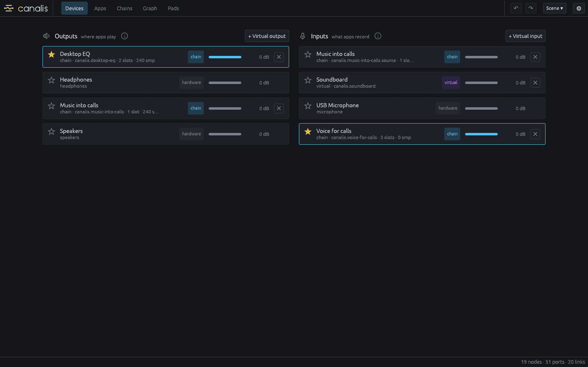
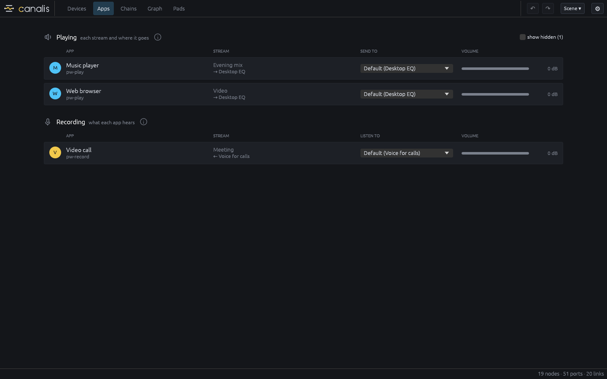
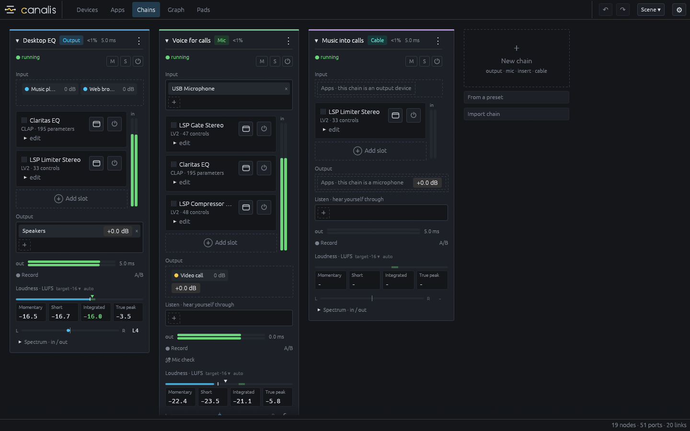
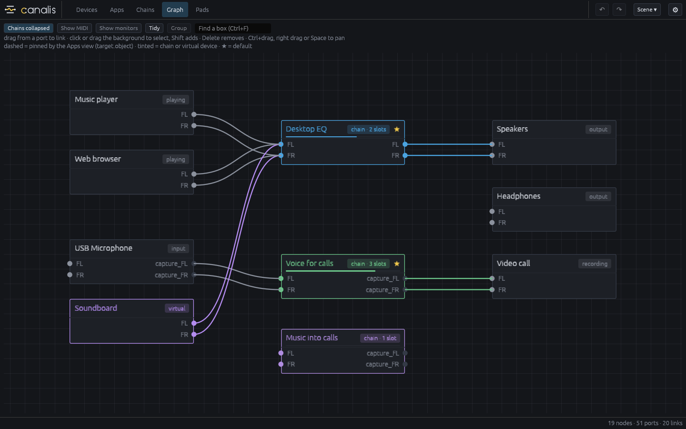
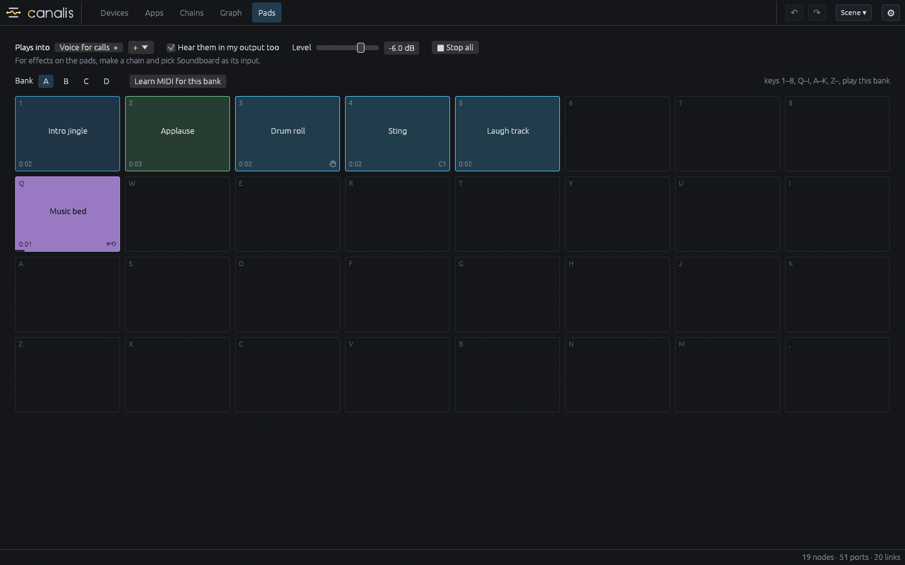
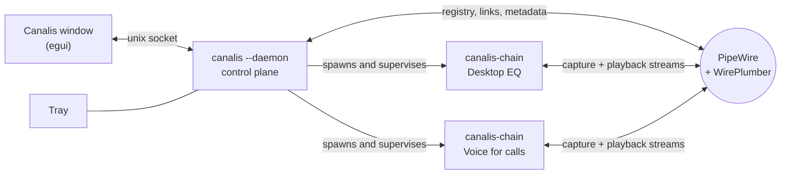

<p align="center">
  <picture>
    <source media="(prefers-color-scheme: dark)" srcset="assets/canalis-lockup.svg">
    
  </picture>
</p>

<h3 align="center">The audio console the Linux desktop never had.</h3>

<p align="center">
  Virtual mics and outputs · a target for every app · effect chains with any CLAP or LV2 plugin · a patchbay<br>
  One window, on top of PipeWire, and all of it still there after you log in.
</p>

<p align="center">
  
  
  
  
</p>

<p align="center">
  <a href="https://claritas.meltingbots.com/canalis"><b>Website</b></a> ·
  <a href="https://claritas.meltingbots.com/canalis#download"><b>Download</b></a> ·
  <a href="https://claritas.meltingbots.com/canalis/docs"><b>Docs</b></a> ·
  <a href="https://github.com/claritas-audio/canalis/releases/latest"><b>Releases</b></a>
</p>

---

Put an EQ on everything your laptop plays. Clean up your mic for calls. Send Discord to your
headphones and music to the speakers. Duck the music while you talk. On Linux that used to mean
four tools and a shell script that broke at the next login. With Canalis it takes one window and
about a minute.

<p align="center">
  
</p>

## What it does

Four views, a soundboard, and one idea: **every effect chain is a device**, so any app can pick
it like a speaker or a microphone.

<table>
  <tr>
    <td width="55%"></td>
    <td>
      <h3>🔊 Devices</h3>
      <p>Every output and input, real, virtual or chain, with its volume and the ★ default.</p>
      <ul>
        <li>A virtual mic or output in one click</li>
        <li>Rename or hide anything</li>
        <li>Plug in your headphones and a rule makes them the default, through your EQ</li>
      </ul>
    </td>
  </tr>
  <tr>
    <td>
      <h3>🎧 Apps</h3>
      <p>Every app that plays or records, and where it goes.</p>
      <ul>
        <li>Pick a device or a chain per app</li>
        <li>Remembered by app name: Discord is on your headphones again tomorrow</li>
        <li>Defaults go through WirePlumber, never around it</li>
      </ul>
    </td>
    <td width="55%"></td>
  </tr>
  <tr>
    <td width="55%"></td>
    <td>
      <h3>🎚 Chains</h3>
      <p>DAW-style strips that apps see as devices: <i>Desktop EQ</i> is a speaker, <i>Voice for calls</i> a microphone.</p>
      <ul>
        <li>Four kinds: <b>output</b>, <b>mic</b>, <b>cable</b>, <b>insert</b></li>
        <li>Any CLAP or LV2 plugin with its own window, plus Claritas EQ and Comp</li>
        <li>Meters, latency, loudness and spectrum on every strip</li>
      </ul>
    </td>
  </tr>
  <tr>
    <td>
      <h3>🕸 Graph</h3>
      <p>The patchbay: every node, port and link, with chains folded into one box.</p>
      <ul>
        <li>Links snap to the port that fits</li>
        <li>Groups fold into one box; a minimap for big graphs</li>
        <li>Hover a link for its path latency</li>
      </ul>
    </td>
    <td width="55%"></td>
  </tr>
  <tr>
    <td width="55%"></td>
    <td>
      <h3>🥁 Pads</h3>
      <p>A soundboard for calls, streams and recordings: a jingle, applause, a music bed under your voice.</p>
      <ul>
        <li>4 banks of 8 × 4 pads: one-shot, toggle or hold, loop, choke groups</li>
        <li>Plays into your mic chain, so the call hears it after your effects</li>
        <li>Press pads by click, keyboard, a MIDI pad controller, the tray or a keybind</li>
      </ul>
      <p><sub>Switch it on under ⚙ › General › Features.</sub></p>
    </td>
  </tr>
</table>

### Built not to break your audio

<table>
  <tr>
    <td width="50%"><b>🛡 Crashes stay small</b><br>Every chain runs in its own process. A crashing plugin brings back one chain, bypassed, with a notification naming the slot.</td>
    <td width="50%"><b>⏱ No glitches</b><br>A chain that overruns the audio cycle bypasses its slowest slot by itself.</td>
  </tr>
  <tr>
    <td><b>🔇 No howling</b><br>Before a mic reaches your speakers, Canalis asks first.</td>
    <td><b>🔁 Remembers everything</b><br>Saved by name, never by id: back after a PipeWire restart, a reboot or a login, before you open the window.</td>
  </tr>
</table>

### And then some

<table>
  <tr>
    <td width="50%" valign="top">
      <b>🎛 Sound</b>
      <ul>
        <li>Presets: Desktop EQ, Voice for calls, two kinds of ducking</li>
        <li>Headphone correction from thousands of AutoEQ measurements</li>
        <li>Loudness (LUFS, true peak) and an <b>auto</b> level</li>
        <li>A/B compare, live spectrum</li>
        <li>Record any chain; a mic check that can't howl</li>
      </ul>
    </td>
    <td width="50%" valign="top">
      <b>🔌 Plugins</b>
      <ul>
        <li>Install LSP, Calf, ZAM, x42 and Dragonfly from the app</li>
        <li>A DeepFilterNet voice denoiser in one click</li>
        <li>Parallel lanes and sidechain keys</li>
        <li>Hardware inserts through your outboard gear</li>
      </ul>
    </td>
  </tr>
  <tr>
    <td valign="top">
      <b>🎮 Control</b>
      <ul>
        <li>Scenes, recalled by hand or when a device or app appears</li>
        <li>MIDI learn for any knob, pad or plugin parameter</li>
        <li>Keybinds and push to talk from any compositor</li>
        <li>A tray menu; Ctrl+Z for everything</li>
      </ul>
    </td>
    <td valign="top">
      <b>🎙 Everyday</b>
      <ul>
        <li>Share a chain as a file, plugin settings included</li>
        <li>Desktop notifications for crashes, clipping, lost devices</li>
        <li>English, Italiano, Français, Deutsch</li>
      </ul>
    </td>
  </tr>
</table>

## Install

```sh
curl -fsSL https://claritas.meltingbots.com/install.sh | sh
```

The [script](install.sh) enables the COPR on Fedora and the signed APT repository on Ubuntu and
Debian (with `sudo`), so updates come with the system, or puts the tarball under `~/.local`
anywhere else. By hand on Fedora: `sudo dnf copr enable meltingbots/canalis && sudo dnf install
canalis`. The packages and the tarball are also on the
[Releases](https://github.com/claritas-audio/canalis/releases)
page. Every one includes the Claritas plugins.

Then run `canalis`, or open it from your app menu. A Flatpak on Flathub is on the way;
[Getting started](docs/manual/getting-started.md#install) has the details.

**Requirements:** Linux with PipeWire 1.0 or newer and WirePlumber, which is what Fedora,
Ubuntu, Debian and most current distributions ship. LV2 plugins also need `lilv` (and `suil`
for their windows); Canalis offers to install them when it needs them.

## A minute to a better desktop

1. Open **Chains**, pick **Desktop EQ** and click **Create**.
2. In **Devices**, click its glyph so *Desktop EQ* wears the ★. Everything you play now goes
   through it.
3. Press **▣** on the EQ slot and shape the curve while music plays.
4. **⚙ › General › Run at login**. That's it: it will be there tomorrow.

The [docs](https://claritas.meltingbots.com/canalis/docs) cover every view, recipe and command; they are the [manual](docs/manual/README.md) in this repository.

## How it works



- **The service owns the audio.** A user service (systemd, or a plain background process)
  keeps the PipeWire mirror and runs the chains. Closing the window leaves your routing
  playing.
- **One process per chain.** Each chain is a capture and playback stream pair with its slots
  running inside one real-time callback, and third-party plugins load only there, never in the
  window. A crash takes down one chain, which is restarted without the slot that crashed.
- **Real-time safe by rule.** Nothing in the process callback allocates, locks, logs or makes
  a syscall. Buffers are sized up front, and the callbacks talk to the rest of the process only
  through lock-free rings and atomics.
- **Works with WirePlumber.** Defaults and app targets are written to its metadata
  (`default.configured.audio.*`, `target.object`), so the session manager stays in charge and
  nothing races it.
- **Written in Rust**, with `unsafe` only at the libpipewire and plugin-host boundaries and a
  `// SAFETY:` note on every block.

The design decisions are written down in [`docs/adr`](docs/adr), and
[`docs/architecture.md`](docs/architecture.md) walks through the whole thing.

## Build from source

```sh
mise install                     # the pinned Rust toolchain
cargo run -p canalis
```

You need `pipewire-devel` and `clang-devel` (`libpipewire-0.3-dev` and `libclang-dev` on
Debian/Ubuntu), plus the usual X11/Wayland development headers.
`scripts/bundle-claritas.sh` builds the bundled Claritas plugins next to the binaries, and
[`docs/DEVELOPMENT.md`](docs/DEVELOPMENT.md) has the full list, the test setup and the release
process.

```sh
cargo test --workspace
cargo clippy --workspace --all-targets -- -D warnings
```

The logos in `assets/` (dark, light and the app tile) are generated by
`python3 scripts/logos.py`.

## Part of Claritas

Canalis is the routing half of [Claritas](https://github.com/claritas-audio), open-source
audio tools for Linux. Claritas EQ and Comp ship inside it, and anything else you load is a
plugin of your choice.

## License

Canalis is free software under the [GPL-3.0-or-later](LICENSE). The packages also carry
Claritas EQ and Claritas Comp, under the same license. Claritas EQ is a clean-room
implementation: its filters were matched to a reference EQ by ear and by measurement only,
never from the reference's code or binaries. Plugins you add yourself (LSP, Calf, ZAM, x42,
Dragonfly, the DeepFilterNet denoiser) keep their own licenses.
