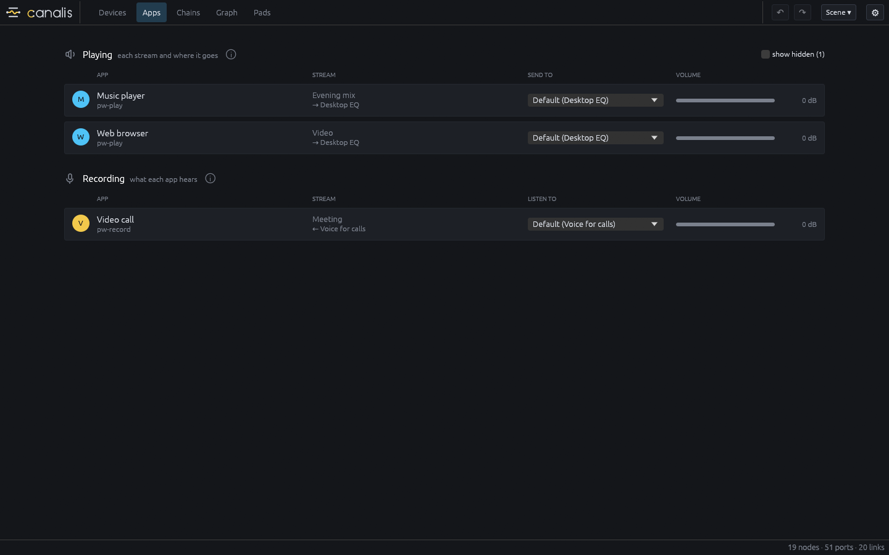

<!-- Part of the Canalis manual: one file per page, the same pages as https://claritas.meltingbots.com/canalis/docs. See docs/manual/MAINTAINING.md. -->

# Apps

Every app that plays or records, where its sound goes, and how loud it is.

Every stream an application has open, playing or recording, has a row.

## Where the sound goes

**Send to** / **Listen to** sets where the stream goes:

- **Default** follows the star in Devices.
- Picking a device or chain pins the stream to it.

Canalis remembers the choice by application name, so Discord lands on your headphones again
next time it starts. Under the stream's name you see where it is linked right now.

## Volume

The **volume bar** sets the stream's own volume, as pavucontrol would.

## Name, colour and hiding

- Double-click the app's name to give it your own.
- Right-click for a **colour** (the avatar and its graph box) and **Hide**.

All three are remembered by application name.

<!-- nav: generated by scripts/manual.py -->

---

← [Devices](devices.md) · [Contents](README.md) · [Chains](chains.md) →
