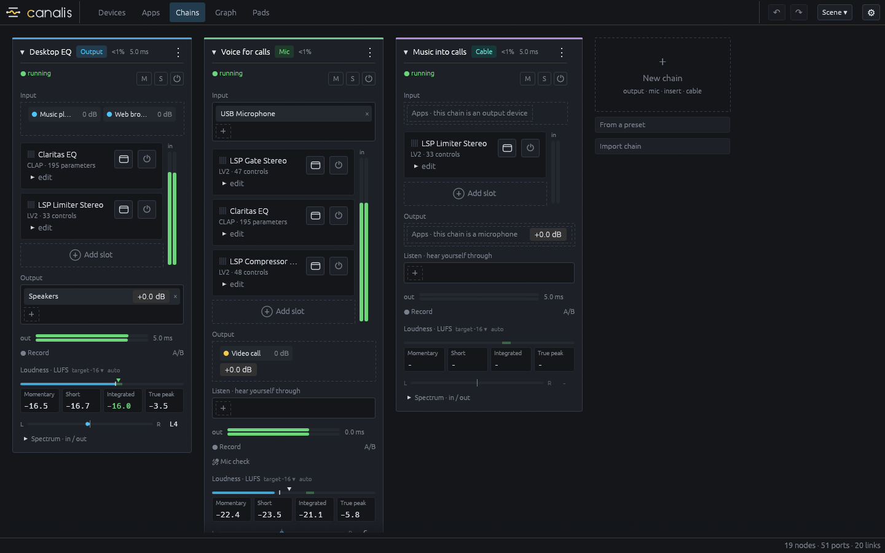

<!-- Part of the Canalis manual: one file per page, the same pages as https://claritas.meltingbots.com/canalis/docs. See docs/manual/MAINTAINING.md. -->

# Chains

Effect strips that your apps see as devices: build one, fill it with plugins, and send it wherever you like.

A chain is a strip: input end → slots → output end, with meters at both ends and the
latency it adds in the footer.

## Kinds of chain

Four kinds exist, told apart by the coloured edge and the tag in the header:

| Kind | Input end | Output end | Typical use |
|---|---|---|---|
| **output** | apps play into it (it is a device) | devices you pick | Desktop EQ |
| **mic** | devices you pick | apps record from it (it is a device) | Voice for calls |
| **cable** | apps play into it | apps record from it | music into a call |
| **insert** | nodes you pick | nodes you pick | a reverb bus between chains |

## The strip

### Names, colours and order

Double-click a chain's name to rename it. Its process restarts so PipeWire shows the new
name.

The **…** menu has:

- **Rename**;
- a colour palette for the strip edge and graph links;
- an icon for the header and the graph;
- **Delete**.

Drag the **⋮⋮** grip to put strips in another order. Drag a slot by its name to move it
within the chain.

In Devices, double-click or right-click a device's name to give it your own. The PipeWire
name underneath never changes.

### Header buttons

The header's three squares are console buttons:

- **M**: fades the chain's output to silence (kept across restarts).
- **S**: solos it by muting every other chain until you click it again.
- **B**: bypasses every slot at once for an A/B.

### Footer meters

The footer shows the output meter, the latency, and the loudness of what leaves the chain:

- **M**: momentary.
- **S**: short-term.
- **I**: integrated (green within a step of −16 LUFS, the streaming target; orange above).
- **TP**: true peak (red above −1 dBTP).
- **↺**: restarts the integrated measurement and the peak hold.

### Latency

Next to the kind, the header shows the delay the chain's slots add, in milliseconds. It
counts plugins' own latency, lanes lined up to the slowest, and a hardware insert's
measured round trip. Hover it for the samples, the graph's rate and each slot's share.

On a **mic** chain past 20 ms it turns orange with a ⚠: that much is heard as a lag in a
call. A lighter denoiser or fewer look-ahead plugins bring it down. The footer repeats the
figure.

### DSP load

The strip's header also shows the chain's DSP load: the most of an audio cycle it used in
the last half second, orange above 70%. Past 100% audio would drop out, so the chain
bypasses its slowest slots on its own and the slot says so.

## Inputs and outputs

Ends are chip boxes: **+** adds a device or another chain, **×** removes one.

- Several inputs are summed.
- Several outputs each get a copy with its own level. Drag the **dB** value on an output
  chip, or double-click it to type one; at the bottom of its range it reads **off**.

A pick that would make audio loop is refused.

## Sidechain keys

When a slot's plugin has a sidechain input, a **Key** box appears under the Input. Pick a
mic, a mic chain or an app there, and every such slot hears it on its sidechain while the
music keeps flowing through the main path. That is how ducking works.

## Slots

Slots run top to bottom.

### Slot cards

Each card shows:

- the processor and a line about it;
- **▣**: opens the plugin's own window;
- **B**: bypass;
- **edit**: unfolds the dry/wet mix, the processor's controls and **Remove slot**.

The controls are one row per parameter. The plugin window is the better editor when it has
one.

Adding plugins, and what happens when one crashes, is in [Plugins](plugins.md).

### Hardware insert

**Hardware insert** is a slot too. The signal leaves through an interface output pair,
goes through your outboard gear and comes back through an input pair (pick both under
**edit**).

**Measure** sends a click through the loop and times its return, so the chain reports the
right latency. Measure again when the gear or the interface's buffer changes.

### Parallel lanes

**Parallel lanes** is a slot that holds lanes. Each lane is a small slot list on a copy of
the signal, summed back with its own level and mute.

- Parallel compression is a dry lane next to a lane with a compressor.
- A multiband by hand is three lanes with a filter each.

Lanes are lined up to the slowest one, so the sum stays in phase. The sum is divided by the
number of unmuted lanes, so lanes left at 0 dB come back at 0 dB rather than louder.

## Undo

**Ctrl+Z** and **Ctrl+Shift+Z**, or the arrows at the top right, undo and redo:

- routing: links, targets, defaults, chain ends, mutes, levels;
- chain edits: slots added, removed or moved, bypass, dry/wet, plugin parameters set in
  the strip, a rename, a colour.

## Sharing chains

### Export

A chain's **⋮** menu has two ways out:

- **Export to file…**: opens your desktop's file chooser in `~/Documents/Canalis` with
  `<name>.canalis-chain.toml` filled in (save it anywhere, under any name).
- **Copy to clipboard**: to paste in a chat.

Either carries the slots with every plugin's settings, the name, kind, colour, icon and
loudness target. It does not carry your devices, routing or levels, which mean nothing on
another computer.

### Import

**Import chain** lists **Your chains**, the ones in `~/Documents/Canalis`, each with its
kind and plugins and an **Import** button. That folder is where Export saves, and a good
place to keep the ones colleagues send.

To bring in another one:

- use **Import chain** under the New chain card, then **Choose file…**;
- or paste the text there;
- or drop the file (any `.toml`) on the Canalis window.

The chain gets your default devices, as a preset does, and your default microphone as its
key if it had one.

Plugins are found wherever your distribution installs them. The ones you do not have are
named in the status bar, and their slots show as missing until you install them
(**⚙ › Plugins**).

> [!NOTE]
> A file from a newer Canalis is refused with a note to update.

<!-- nav: generated by scripts/manual.py -->

---

← [Apps](apps.md) · [Contents](README.md) · [Plugins](plugins.md) →
