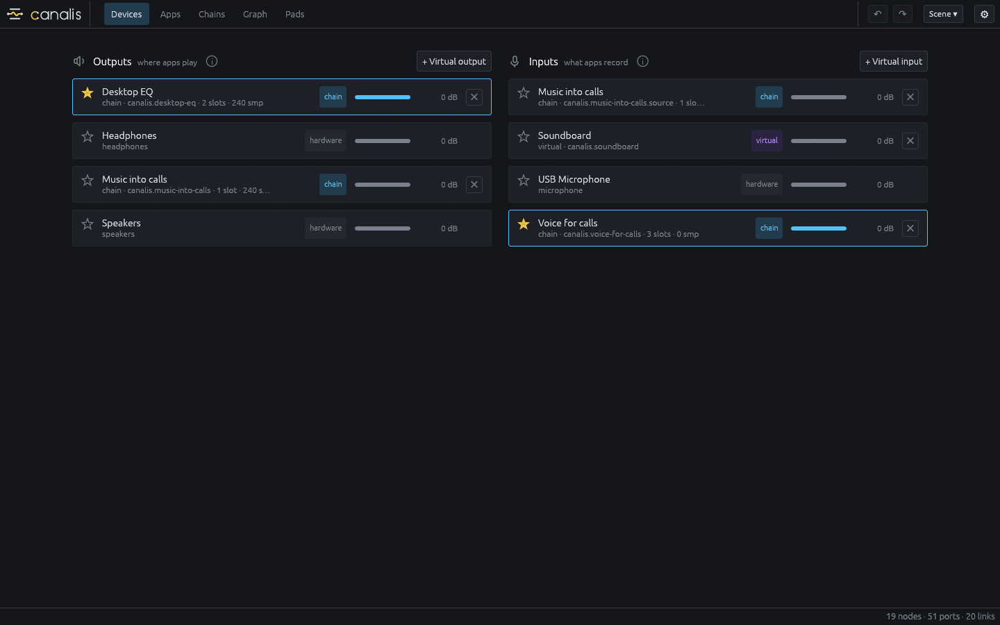

<!-- Part of the Canalis manual: one file per page, the same pages as https://claritas.meltingbots.com/canalis/docs. See docs/manual/MAINTAINING.md. -->

# Devices

Every output and input on your desktop, real, virtual or chain, with its volume and which one is the default.

## Reading the view

Two columns:

- **Outputs**: where apps play.
- **Inputs**: what apps record.

Each row is a device with its name, a tag (**hardware**, **virtual**, **chain**), a volume
bar you can drag and the level in dB.

## The default device

The **star** marks the default. Click the glyph at the left of a row to make it the
default; WirePlumber moves the apps that follow the default.

## Virtual devices

**+ Virtual output** and **+ Virtual input** create a device that only exists in PipeWire.
Send apps into it from **Apps**, record it from OBS, or feed it into a chain.

The cross at the right deletes a virtual device.

## Chains as devices

A **chain** row is a chain from the Chains view: it is a device too, which is the point.

## Renaming and hiding

- Double-click a name to rename it (PipeWire's own name is untouched).
- Right-click for **Hide**. Hidden devices leave the views and the graph.
- **show hidden** in the column header lists them dimmed, with **Show** in the same menu.

## When a device connects

Right-click a hardware device (your Bluetooth headphones, a USB headset) and pick **When it
connects…**. Then, each time it is plugged in or paired:

- **make it the default output** (or input), **directly** or **through** a chain: pick
  "Headphones EQ" and everything plays through the chain into the headphones;
- **recall a scene**;
- **put the previous defaults back when it disconnects**, on by default: the output and
  input you had before come back, unless you picked another one while it was connected,
  which then stays.

### Managing rules

A device with a rule wears a **rule** tag instead of **hardware**. Click it to change the
rule, hover it to read what it does.

Rules of devices that are not plugged in stay listed, dimmed, under their column, with
**edit** and **×**.

> [!NOTE]
> A rule fires when the device arrives, not for one already there when Canalis
> starts. For anything else that should happen when a device or an app appears, a scene can
> recall itself ([Scenes](control.md#scenes)).

<!-- nav: generated by scripts/manual.py -->

---

← [Getting started](getting-started.md) · [Contents](README.md) · [Apps](apps.md) →
