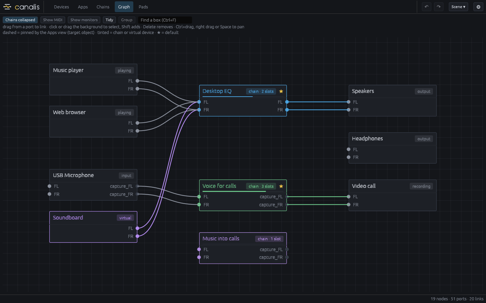

<!-- Part of the Canalis manual: one file per page, the same pages as https://claritas.meltingbots.com/canalis/docs. See docs/manual/MAINTAINING.md. -->

# Graph

The patchbay: every node, port and link on your desktop, to see and change the routing directly.

The patchbay. Boxes are nodes with inputs on the left and outputs on the right. A chain is
one box with the chain's colour unless **Chains collapsed** is off.

## Linking

Drag from a port to link:

- The ports that can take the link light up: audio to audio, MIDI to MIDI, not the same
  box, not linked already.
- The cable snaps to the nearest one.
- Let go over a box and it picks that box's port on the same channel.
- Esc drops the cable.

The pointer tells what is under it: a hand over a port or a link, a closed hand while moving
a box, a crosshair while drawing.

## Selecting

- **Click** a box or a link to select it.
- **Shift+click** adds it to the selection or takes it out.
- **Drag on the empty background** to draw a marquee. It selects the boxes it touches and
  every link it crosses; with **Shift** it adds to what is already selected. What it would
  select lights up while you draw.
- **Ctrl+A** selects everything.
- **Ctrl+D**, Esc or a click on empty space clears.

Dragging a selected box moves the whole selection.

## Deleting

**Delete** (or Backspace) removes the selected links at once (**Ctrl+Z** brings them back).
A selected chain or virtual device is deleted after you confirm, while a hardware device or
an app's stream only loses its links.

Right-click a link for **Remove link**, a box for **Remove links** and, for what Canalis
made, **Delete…**.

## Moving around

- **Pan** with the middle or right button, or hold **Ctrl** or **Space** and drag.
- **Scroll** to zoom.
- **F** (or a double-click on empty space) fits everything in view.
- **Shift+F** fits the selection.

## Finding a box

**Ctrl+F** finds a box by name: pick it and the view centres on it while it glows for a
moment.

## Layout

- The **arrow keys** nudge the selected boxes (Shift for bigger steps).
- **Tidy** lays everything out again, or only the selection when there is one.

Moving boxes, nudging and Tidy go through **Ctrl+Z** like routing does. The camera and box
positions are kept in `~/.local/state/canalis/graph.toml` for the next window.

## Reading the graph

### Links and latency

Hover a link to see what it joins, "Firefox → Desktop EQ (FL→FL, FR→FR)", with both ends
lit. It also shows the path latency through it: what PipeWire counts from where the sound
comes in up to the link plus from the link to where it goes out (buffers, chains, devices),
at the graph's current quantum and rate.

Hovering a box shows the same two halves for that box.

### Marks on boxes and links

- A chain's box carries its output level, a thin bar under its name.
- Dashed links are streams pinned from Apps.
- The star marks the default device.
- **Show MIDI** and **Show monitors** reveal what is hidden by default.

## Groups

**Group** (or **Ctrl+G**) puts the selected boxes in a named, coloured frame. Drag the
frame's title to move them all.

Right-click the title to:

- rename the group;
- pick its colour;
- **Fold group**;
- **Ungroup**.

### Folded groups

A folded group is one box that keeps only the ports linked outside it (the links inside are
hidden). Double-click it, or right-click → **Open group**, to open it where it now sits.
Double-clicking an open group's title folds it.

### Membership

A box belongs to one group at a time: grouping it again takes it out of the old one, and a
group left with a single box dissolves. Groups are kept with the layout.

## Minimap

When the boxes no longer fit in the view, a minimap appears in the bottom-right corner:
every box in its colour, the visible area outlined. Click or drag in it to move the view.

<!-- nav: generated by scripts/manual.py -->

---

← [Sound tools](sound-tools.md) · [Contents](README.md) · [Soundboard](soundboard.md) →
