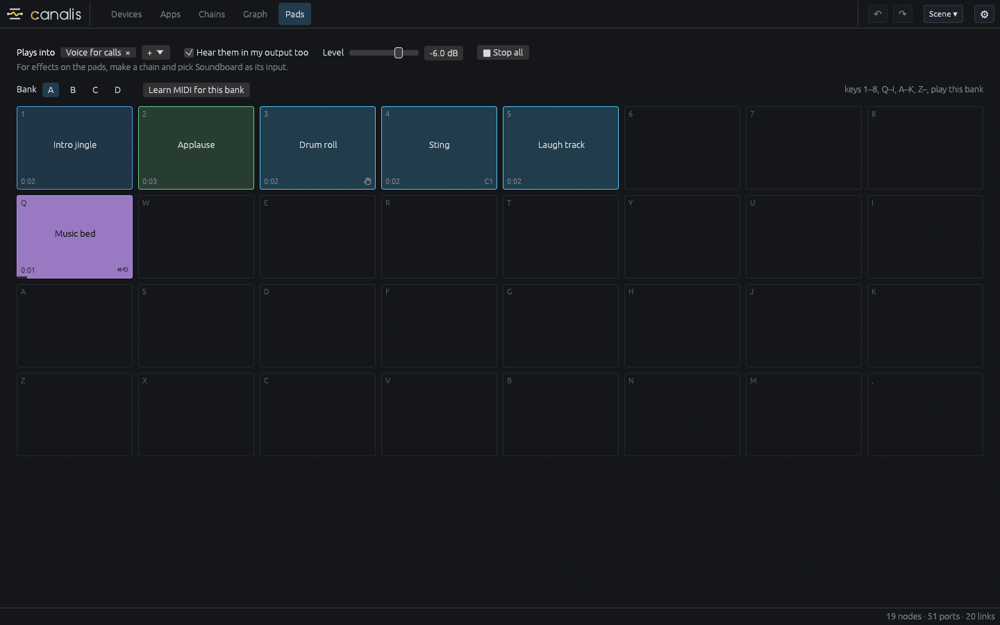

<!-- Part of the Canalis manual: one file per page, the same pages as https://claritas.meltingbots.com/canalis/docs. See docs/manual/MAINTAINING.md. -->

# Soundboard

Pads of sounds for calls, streams and recordings, played by click, key, MIDI controller, tray or command line.

Pads of sounds that a call, a stream or a recording hears: a jingle, applause, a sting, a
music bed under your voice.

## Switching it on

Switch it on under **⚙ › General › Features › Soundboard**; a **Pads** tab appears after
Graph.

The first time, the board plays into your first mic chain's virtual mic (so a call hears
it, after the chain's effects) and into your own output.

## Adding sounds

The tab is a grid of 8 × 4 pads per bank, four banks (**A**–**D**).

- Click an empty pad to pick a sound file: WAV, FLAC, MP3 or Ogg, up to five minutes. The
  chooser opens where the last one came from.
- Or drop files on the grid.

## Playing pads

Press a pad in any of these ways:

- Click it.
- Press its key: **1**–**8**, **Q**–**I**, **A**–**K**, **Z**–**,** play the bank in view.
  **Esc** stops everything.
- From a MIDI controller (see [MIDI controllers](#midi-controllers)).
- From the tray.
- With `canalis pad`.

A playing pad lights up and shows the time left with a bar; an idle one shows its length.

## Pad settings

Right-click a pad for its settings, or double-click it to rename it.

### When pressed

- **One-shot**: plays to the end and starts over if pressed again (effects, stings).
- **Toggle**: starts on one press and stops on the next (beds, music).
- **Hold**: plays while you hold the pad, its key or its MIDI note.

### Loop

**Loop** is for beds. A looping one-shot plays until you stop it.

### Choke group

Pads in the same **Choke group** cut each other off (an intro and an outro). Pads with no
group play over everything.

### The rest

- **Gain**
- **Colour**
- **Stop**
- **Replace file…**
- **Remove pad**
- **Learn MIDI control**

Every stop and retrigger fades out over 20 ms, so nothing clicks.

## Where it plays

The controls on top of the tab:

- **Plays into**: lists where the board goes. **×** removes one, **+** adds any output or
  virtual mic.
- **Hear them in my output too**: follows your default output.
- **Level**: sets the whole board.
- **■ Stop all**: cuts every pad.

The board is a device called **Soundboard**, like a mic. It shows in the Graph, and a link
you draw from it there is one more place it plays into.

## Effects on the pads

To put effects on the pads, make a chain and pick **Soundboard** as its input.

## MIDI controllers

**Learn MIDI for this bank** maps a controller in one go: press its pads one by one in the
order of the grid (left to right, top to bottom).

A Launchpad or any pad controller works. A note plays the pad, and its release lets a Hold
pad go.

<!-- nav: generated by scripts/manual.py -->

---

← [Graph](graph.md) · [Contents](README.md) · [Scenes, tray and control](control.md) →
